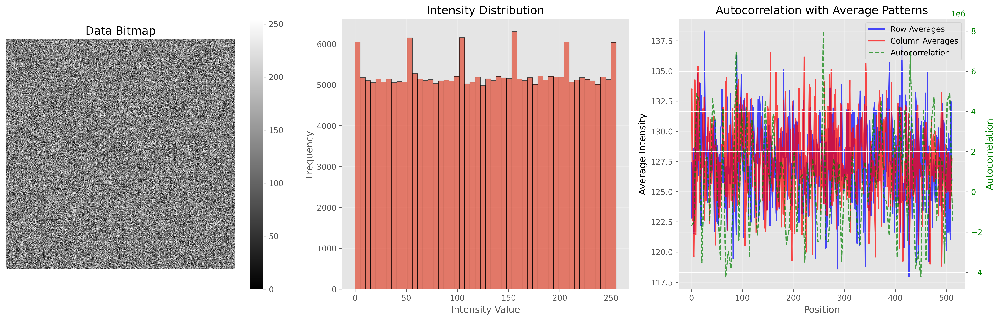
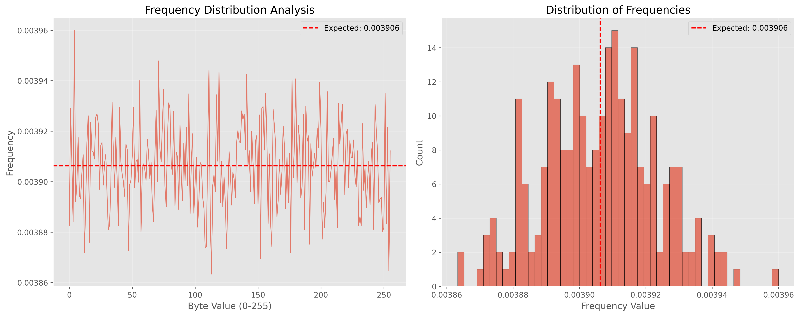

<!-- _class: lead title -->
<!-- _paginate: false -->
<!-- _footer: '' -->

# Lokey

## Entropy for the stack you already run

Hardware randomness, fed into firmware, the kernel, virtio, and containers.

<!--
Open on the audience's stack. The talk has five sections: what cryptography spends, what randomness requires, the process they already consume, a process they can own, and the sectors that borrow someone else's process. About thirty minutes.
-->

---

# Cryptography spends entropy

- A cipher, a hash, or a signature preserves the unpredictability it is given.
- The search is the set of keys, nonces, salts, and seeds that might have been used.
- An algorithmic generator becomes easier to attack as quantum computing advances. A physical source is not a seed that can be stolen.

<!--
A hash, a key-derivation function, and a signature are deterministic. The width of the digest is not the size of the search. The attacker walks the inputs.
Quantum stays this one clause, as the site states it: algorithmic randomness gets easier to exploit, and physics-based entropy is not a stolen seed. Do not open a quantum section.
-->

---

# A small input set is a brute-force set

- Structured or guessable content shrinks that set.
- Short length bounds it, even when every bit looks noisy.
- A biased nonce can leak a private key from a sound signature scheme.
- A short one-time password, and a key minted at first boot, are the same thin set.

<!--
Two ways the candidate set gets small, taught as one idea: content and length.
The sharp case is a biased or reused nonce. ECDSA can be a correct algorithm and still expose the private key when the nonce was predictable.
Hold this. The cold Linux pool, the short banking password, and a seed the team did not run are the same failure later.
-->

---

<!-- _class: lead -->

# A process, not a sample

Randomness is a claim about how the bytes were made, and how they reached you.

<!--
Section two. Leave the stake behind. From here, noisy output is not the definition of randomness. The next slides say what the claim requires, and why an outsider is biased toward thinking a sample is random.
-->

---

# Randomness cannot be observed

- A finite sample can always be the output of a deterministic program.
- There is no procedure that finds the shortest such program.
- A cryptographic generator is built to be indistinguishable from an ideal source.
- Inspection of the output cannot certify the source.

<!--
Kolmogorov complexity is uncomputable, which is the formal name for the second line. You cannot prove a finite string random by reading it.
A CSPRNG is defined to pass as ideal randomness. If the construction works, no suite you run can tell the generator from a physical source.
This slide only says inspection fails. The requirement comes next. Do not try to carry the whole argument from this slide.
-->

---

# Randomness is the process

- Noisy output is not the definition.
- The claim is about how the bytes came to be.
- The path that delivered them is part of that claim.
- A sample, held on its own, is not yet a process.

<!--
Say this slowly. The audience has just been told they cannot certify a string. The move is: stop looking at the string, and look at the process, including the path. The next slide names the three requirements that make the claim available.
-->

---

# Three requirements

- Transparency. Every step from the noise to the byte can be read.
- Openness. No closed step sits in the path.
- Ownership. You run the process. Receiving bytes is not running it.
- The claim is available only when all three hold together.

<!--
Give them the three words to hold: transparency, openness, ownership. The next three slides unpack one each. Do not let a certificate, a vendor letter, or a test report sneak in here as a fourth substitute. That attack belongs on the openness slide.
-->

---

# Transparency

- Every step from the noise source to the byte you use can be read.
- A hidden step is a process you do not have.
- Reading the output is not reading the step that made it.
- Without that reading, you hold a sample, not a process.

<!--
Transparency is about the steps, not the vibe of the data. A published bitmap is a picture of the sample. It is not a reading of the noise source, the mixer, or the delivery path.
-->

---

# Openness

- A closed implementation is a step you cannot read.
- A NIST certificate does not open that step.
- A vendor assurance does not open that step.
- A published test report does not open that step.

<!--
Say this before the ATECC608B appears, so the certificate later cannot be heard as ownership. The certificate can be real and the step can stay closed. Both are true. Openness is whether you can read the step, not whether an authority signed a report.
-->

---

# Ownership

- You run the process on systems you control.
- A file handed to you is not a process you ran.
- A CPU instruction you did not design is not a process you ran.
- An API response from someone else is not a process you ran.

<!--
Ownership is operational. If the bytes arrived from outside the boundary you run, you did not run the process. This is the line that later splits on-device operation from a hosted feed, and virtio from a guest that only receives.
-->

---

# Someone else's bytes cannot be assumed random

- The delivery path is part of the process.
- If that path is not auditable, you do not hold a random process.
- A distant lab can have been honest. The assumption is still unavailable.
- These bits are not claimed to be known fakes.

<!--
Do not allege a backdoor. The claim is that the assumption is unavailable. Honesty at a lab you cannot survey does not give you a process. The path that carried the bytes is the process you actually hold, and that path was not auditable.
-->

---

# From outside, it only seems random

- An outsider sees only the sample.
- A generator that works is built so that sample seems random.
- That seeming is the bias of being shut out of the process.
- "It looks random" is the impression you were guaranteed.

<!--
This is not the psychology-textbook meaning of observer bias. It is the structural bias of an observer who does not own the generating process.
Because a cryptographic generator is defined to be indistinguishable from an ideal source, the outsider's impression is not evidence. It is what the construction promises them.
-->

---

# A passed test can be the bias confirming itself

- Dieharder, a flat histogram, and a static bitmap can reject a bad sample.
- Read from outside a process you do not own, a pass is the guaranteed impression.
- A test can throw a process out.
- A test cannot grant the assumption.

<!--
Tests remain useful to an owner: they falsify. They do not transfer ownership, and they do not make someone else's bytes assumable.
The published plots later in the talk are held to this standard. Say "we did not catch a deviation," not "we proved it random."
-->

---

<!-- _class: lead -->

# The randomness you already use is someone else's

Intel, AMD, NVIDIA, and the kernel pool hand you bytes from a process you do not run.

<!--
Section three. Everything just argued now has an address: the chips in the machines they already operate, the kernel that mixes those chips in, and virtio, which forwards the result. No new worry. Instances.
-->

---

# These chips are someone else's process

- Intel and AMD, on the CPU. NVIDIA, on the accelerator.
- You receive their bytes. You do not run their noise source.
- The sample seems random because you are outside the process.
- This is not a claim of a known backdoor.

<!--
Entropy hardware in general-purpose machines is dominated by designs from the United States. Say that if you need the market context. The slide's claim is ownership, not geography.
Do not claim a known backdoor. A well-behaved generator passes the same suites whether or not the analog source is honest. That was the observer slide.
-->

---

# Complexity is why you cannot take ownership

- The noise source sits in silicon too large to survey.
- You cannot make their process yours by reading the output.
- A well-behaved sample passes the same tests either way.
- Ownership would require a process you can take apart.

<!--
Complexity blocks the process question. The output question was already blocked: inspection cannot certify a sample. Together, RDRAND-style generators cannot be taken over by the operator. They stay someone else's process for the life of the machine.
-->

---

# Linux mixes what it is given, and it starts cold

- The kernel credits entropy across the life of the machine.
- That credit includes sources the owner did not build.
- At startup the pool is thin, so the first keys are a smaller search.
- A freshly cloned guest starts cold again, even when the image is old.

<!--
Two facts, one slide. The pool accumulates over uptime, and what it accumulates includes the CPU generator you do not own. The dangerous window is before the pool has accumulated entropy: first boot, and every new guest kernel.
Host keys, disk-encryption keys, and first service credentials are drawn then. That is the brute-force point from the opening.
Modern getrandom waits for initialization. Do not say that every later cryptographic call on a long-running host is predictable.
-->

---

# Each layer inherits the one below

<ol class="ladder">
  <li>Firmware Secure boot, device identity, and disk unlock. Before any OS.</li>
  <li>Hardware The CPU and GPU generators, or a discrete element beside them.</li>
  <li>Kernel The pool fills over time. It is thin at boot.</li>
  <li>Virtual kernel virtio-rng delivers whatever the host injects.</li>
  <li>Containers Pods share that kernel. A library spends what the kernel had.</li>
</ol>

<!--
Read top to bottom. Each rung that receives entropy is accepting someone else's bytes. The next slide isolates virtio, because that is where a guest mistakes a message for a process it ran.
-->

---

# virtio is a message from someone else

- A guest does not invent entropy.
- virtio-rng delivers whatever the host injects.
- A pod shares that kernel and has no pool of its own.
- The guest that did not run the process cannot assume the feed is random.

<!--
A container has no private pool. A cloud-native pod is that container scheduled at scale. If the host's source is an unauditable CPU generator, or a pool that was thin when the guest booted, every tenant inherits that process.
An API that only applications call leaves firmware, the guest kernel, and unmodified pods on someone else's bytes.
-->

---

<!-- _class: lead -->

# Put the process where you run it

Lokey is the software that feeds the consumers you already have, from a process you operate.

<!--
Section four. The product is the answer to the requirement. Do not let the closed chip satisfy the requirement. It proves integration. The open circuit is what can be owned.
-->

---

# Lokey feeds the consumers you already run

- Firmware reads a discrete part.
- The kernel pool is fed, and virtio-rng carries that feed into the guest.
- Containers inherit the host kernel, so the pod needs no code change.
- An API and a CLI remain for callers that want an explicit stream.

<!--
The point is where the process sits: with the operator, at the rungs the stack already reads. Workflows keep their consumers. Asking only applications to call a new API would leave firmware, the guest, and unmodified pods untouched.
-->

---

# The closed part does not meet the requirement

- Now: the Microchip ATECC608B. Closed source, certified under NIST SP 800-90.
- The certificate is real. It does not confer transparency, openness, or ownership.
- It sits beside the CPU, and it is enough to prove the software integrates.
- It remains someone else's process.

<!--
NIST program name, confirmed from public records. Do not lead with a certificate number.
If asked: the ECC608 physical noise source is on NIST's SP 800-90B entropy validation for the ATECC608B, certificate E46. The ATECC608B counter DRBG is on the CAVP list, certificate C1777. Microchip's documentation says the generator is designed to meet SP 800-90A, B, and C.
The certificate can be true and the requirement can still fail. Say both. The part is a bounded stand-in used to prove the software, not a process the operator can read.
-->

---

# A bounded part can be removed

- The CPU and GPU generators are part of the machine.
- The ATECC608B is a small module beside the CPU, and it can come out.
- Behavioral tests still only falsify, for either source.
- Removal is what makes a later survey possible.

<!--
The earlier critique was complexity, and a source that cannot be swapped out of the machine. The ATECC608B can come out. That does not make the closed part transparent. It makes the next source installable without asking the CPU vendor.
-->

---

# The open circuit is the requirement

- Next is an open-source discrete circuit, itself certified, so the closed part can be retired.
- That circuit is the open hardware device on the site, aimed under €50.
- A certificate on an open design is a check you can read.
- The certificate is not a substitute for the design being open.

<!--
The €50 figure is the site's phase-1 aim for an open-source hardware device and ecosystem. It is a destination, not a price we claim to ship today.
Certification of an open design is a check an owner can read beside the design. It does not replace openness. This is the process that can meet transparency, openness, and ownership together.
-->

---

# Conditioning is a step you can read

- The ATECC608B amplifies thermal noise, outside the host CPU.
- Open-source health checks watch the stream for bias and faults.
- Fortuna, from Bruce Schneier and Niels Ferguson, mixes the raw bits.
- The result leaves through the rung the consumer already uses.

<!--
Four beats from the site: physical capture, open supervision, Fortuna, then delivery.
Fortuna hardens the stream against a partial hardware failure. It does not certify that randomness was observed. It is a step an owner can read.
The source sits outside the host CPU, so a compromised OS or hypervisor does not determine the raw noise.
If asked about the NIST write-up: certificate E46 describes the ECC608 source as a physical ring-oscillator noise source. The site describes that same noise as thermal. Same part.
-->

---

# Jurisdiction is not ownership

- On-device or air-gapped, you run the process.
- Hosted in the EU, the pipeline stays under GDPR.
- As the site states it, that path sits outside the Patriot Act and the CLOUD Act.
- Those bytes are still someone else's process until you run it yourself.

<!--
Keep the two modes distinct. Local and air-gapped is the mode that meets ownership: the operator runs the process. The hosted API is the hero and the EU section of the site. Jurisdiction is real. It does not make a received stream into a process the recipient ran.
Do not describe the two modes as one promise.
-->

---

# We did not catch a deviation

<figure>

<figcaption>Each pixel is one byte. Structure would show. This looks like static.</figcaption>
</figure>

<figure>

<figcaption>Byte values 0–255. A spike or a gap would be bias.</figcaption>
</figure>

45 of 46 Dieharder tests. A healthy generator is expected to fail about 1–5%. Mean intensity about 127.5, standard deviation about 73.9. No cookies or trackers. The code is open.

<!--
Read the title before the numbers. These pictures are what an observer sees. A clean picture is not the claim. The claim is the process.
45 of 46 is the published figure. The 1–5% caveat is the site's own: a single failure is expected for a healthy generator. Full logs are in the GitHub knowledge base.
Mean intensity about 127.5 and standard deviation about 73.9 are the site's figures for uniform byte coverage.
We publish the pictures because we refuse to treat them as proof.
-->

---

<!-- _class: lead -->

# Four places the process is borrowed

Government, banking, cloud, and AI already consume randomness at a rung they do not always run.

<!--
Section five. The four cards on the site, judged by the requirement. Facts stay inside those cards. The failure line is the requirement failing there.
-->

---

# Four sectors, four rungs

- Government, at firmware and in the application.
- Banking and finance, at the HSM or KMS already in the room.
- Cloud, at the virtualized kernel and in cloud-native pods.
- AI and machine learning, in the application process.

<!--
The rung name in the corner of the next slides is which consumer is speaking. The job lines are the website's. The failure lines are the requirement, applied to that job.
-->

---

<!-- _header: Firmware and application -->

# Government

Job

Identity, voting, notarization, and public lotteries.

Failure

A signing key or a public draw, minted by a process the public cannot run, is someone else's randomness with a public name.

Lokey

Signature keypairs, certificate issuance, and draws that can be disclosed and challenged, from a process the operator runs.

<!--
Website facts: digital-signature keypairs and certificate issuance. Secure digital voting or lottery randomness that can be disclosed.
The failure line applies the requirement. A thin boot pool and a vendor-minted draw are the same kind of borrowed process. Integrity means every key, token, or draw can be challenged, and the process that made it can be run by the operator.
-->

---

<!-- _header: Hardware appliance -->

# Banking and finance

Job

Transaction IDs, one-time passwords, onboarding, and device provisioning.

Failure

A short password is a small search, and a seed the bank received rather than ran is an assumption.

Lokey

Verifiable entropy into the HSM or KMS seed pools you already run, and tamper-evident logs for auditors. Those boxes stay.

<!--
The site is explicit: Lokey adds hardware entropy without ripping out existing HSMs. Say "those boxes stay" and mean it.
The short one-time password is the length side of the opening. The received seed is the ownership side.
The second website bullet is tamper-evident randomness logs for audits and regulators.
-->

---

<!-- _header: virtio and containers -->

# Cloud

Job

Isolate tenants, encrypt workloads, and issue credentials that cannot be replayed.

Failure

The guest receives the host's process. Every pod on that kernel inherits it.

Lokey

A per-tenant feed the operator runs, carried through virtio into VMs, containers, and serverless workloads, and into the secrets service.

<!--
Website facts: per-tenant entropy for VM, container, and serverless; secrets management seeded by auditable randomness; API credentials that cannot be replayed.
The failure line is the virtio slide, named as the cloud product. The feed counts only when the operator runs the process. A host that injects unauditable bytes has not met the requirement.
-->

---

<!-- _header: Application -->

# AI and machine learning

Job

Weight initialization, shuffling, differential privacy, Monte Carlo sampling, and reinforcement learning.

Failure

A guessable seed makes privacy noise predictable, and a seed the team did not run only seems random.

Lokey

Hardware entropy where guessability is the risk. A recorded seed where the run must be replayed.

<!--
The site says both "reproducible research" and "truly random seeds." Keep them apart. Record a seed when a run must be replayed. Read hardware entropy where guessability is the risk: privacy noise, unpredictable sampling.
A recorded seed is a deliberate, logged input. It is not a claim that the sample was observed to be random.
"Only seems random" is the observer bias, applied to a seed the team received.
-->

---

<!-- _class: lead -->
<!-- _paginate: false -->
<!-- _footer: 'Phase 2 and 3: early adopters, then geographic scale. Not this talk.' -->

# Integrate the stack now. Own the source next.

The software on the NIST SP 800-90 part is what integrates today. That part does not meet the requirement.

The open circuit is what does.

Early adopters on the site: government, banking, and cloud.

[Knowledge base](https://github.com/LokeyTRaaS/Knowledgebase) · pieter@lokey.cloud

<!--
Close on the requirement. What integrates now is the software on the certified part. That part remains closed, and the certificate does not confer ownership. What meets the requirement next is the open discrete circuit.
Early adopters named on the site are government, banking, and cloud. Phase 2 and 3 stay in the footer: developer portal, geographic sources, commercial support. Do not tour them.
The knowledge base holds the Dieharder logs. pieter@lokey.cloud is the contact on the site.
-->
